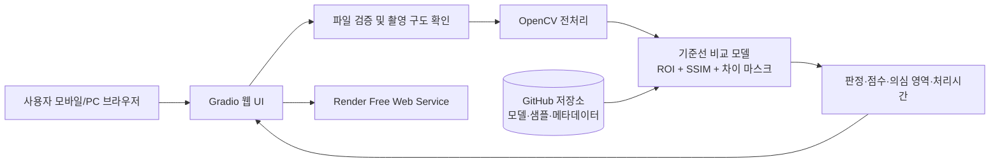

# OSS-Defect inspection
## 부산 수산가공품 포장 불량 사진검사 MVP PRD

- 문서 상태: 공모전 제출용 MVP 초안
- 작성 기준일: 2026-10-15
- 개발 기간: 4주
- 개발 인원: 1명
- 목표 운영비: 호스팅 월 0원 목표
- 선택 주제: 수산가공품 포장 불량 자동검사

> **문서 표기 규칙**
> - `[사실]`: 현재 입력 또는 공식 문서에서 확인한 내용
> - `[가정]`: 개발을 진행하기 위해 임시로 둔 전제
> - `[제안]`: MVP의 성공 가능성을 높이기 위한 결정
> - 아직 검증하지 않은 정확도, 비용 절감률, 기관 협력 여부는 성과로 표현하지 않는다.

---

## 0. 결정 요약

### 최종 제품 정의

**OSS-Defect inspection**은 부산 서구 원양로 1 인근의 수산가공품 생산·포장 현장을 가정하여, 한 종류의 포장 제품을 정해진 촬영 조건에서 사진으로 업로드하면 포장 불량 의심 여부와 불량 위치·점수를 보여주는 웹 시제품이다.

### MVP에서 검사하는 것

- 대상 제품: `[가정]` 투명 진공 파우치 또는 라벨이 부착된 수산가공품 포장 1종
- 검사 결함: `[제안]` 포장 위치·형상 이상, 밀봉부 주름/개방 의심, 라벨 누락·기울어짐 등 사진에서 보이는 결함
- 입력: JPG/PNG 1장, 최대 10MB
- 처리: 정상 기준 이미지와 비교하는 OpenCV 기반 기준선 검사
- 출력: `정상 가능성 높음 / 확인 필요`, 결함 점수, 의심 영역 표시, 판정 근거
- 운영 방식: 로그인·DB·실시간 센서·공장 설비 연동 없이 1회성 업로드 검사

### 범위 제한 이유

1개월·1명·초보자 조건에서는 다품목·다각도·실시간 카메라·생산라인 PLC 연동·고정밀 딥러닝 모델을 동시에 구현할 수 없다. 따라서 **한 제품, 한 촬영 구도, 세 가지 가시 결함, 오프라인 학습/온라인 추론 분리**를 MVP의 품질 기준으로 삼는다.

---

# ① 제품 개요

## 1. 문제 정의

수산가공품 포장 검사는 생산자가 포장 상태를 육안으로 반복 확인하는 경우가 많다. 이 방식은 다음 문제를 만들 수 있다.

- 검사자마다 정상과 불량을 판단하는 기준이 다르다.
- 작업량이 많을 때 작은 주름, 라벨 이탈, 밀봉부 이상을 놓칠 수 있다.
- 불량 판정의 근거가 사진이나 점수로 남지 않아 교육과 회고가 어렵다.
- 실제 공장 자동검사 장비는 중소 사업장과 공모전 MVP에 비용·설치 부담이 크다.

**문제 가설:** 동일한 제품을 일정한 배경·거리·조명에서 촬영한다면, 단순한 영상 비교만으로도 명백한 포장 이상을 1차 선별하여 사람이 재확인할 대상을 줄일 수 있다.

이것은 품질관리자를 대체하는 제품이 아니라 **사람의 최종 판단 전에 의심 제품을 선별하는 보조 도구**다.

## 2. 부산 지역과의 관련성

- `[사실]` 시범 지역 입력은 `부산광역시 서구 원양로 1`이다.
- `[가정]` 해당 주소를 부산 수산물 유통·가공 활동과 관련된 시범 지점으로 삼되, 실제 입주 업체·생산품·촬영 가능 여부는 기관 또는 사업자 협의가 필요하다.
- `[제안]` 부산 전체로 확장하지 않고 해당 지점 인근 또는 협력 가능한 한 사업장의 한 포장 제품으로 시작한다.
- 공개 시연에는 업체명, 작업자 얼굴, 주문서, 생산량, 라벨의 개인정보·영업비밀을 넣지 않는다.

주소 자체가 생산라인의 존재나 협력 가능성을 의미하지는 않는다. 실제 현장 검증 전에는 “부산 서구 수산가공품 포장 품질관리 문제를 대상으로 한 현장 적용 가설”이라고 표현한다.

## 3. 핵심 사용자

| 사용자 | 실제 목표 | MVP에서 제공하는 가치 |
|---|---|---|
| 소규모 수산가공업체 품질 담당자 `[가정]` | 포장 이상을 빠르게 선별하고 재확인 기준을 통일 | 사진 한 장으로 판정 보조 결과와 의심 영역 확인 |
| 생산·포장 작업자 `[가정]` | 작업 중 포장 상태를 즉시 확인 | 정상 기준 이미지와 비교하여 재작업 여부 판단 |
| 공모전 심사자·산업지원기관 | 지역 문제와 기술 적용 가능성 평가 | 부산 현장 가설, 데이터 흐름, 성능 검증 결과를 한 화면에서 확인 |

## 4. 가치 제안

> “부산 수산가공품 포장을 일정한 사진 한 장으로 먼저 선별하고, 사람이 확인해야 할 이유를 시각적으로 설명한다.”

차별점은 “AI가 불량을 맞힌다”는 표현이 아니라 다음 세 가지를 함께 보여주는 데 있다.

1. 특정 제품·현장 조건으로 범위를 좁힌 현실적인 MVP
2. 정상/불량 판정과 함께 비교 영역 및 점수를 표시하는 설명 가능성
3. 학습 데이터, 검증 데이터, 오탐·미탐을 공개하는 검증 중심 시연

## 5. 시범 범위

- 공간 범위: 부산광역시 서구 원양로 1을 중심으로 한 현장 가설 `[가정]`
- 제품 범위: 수산가공품 포장 1종
- 촬영 범위: 정면 또는 상면 고정 구도 1종
- 결함 범위: 사진으로 확인 가능한 3종 이하
- 사용자 범위: 공개 시연용 비로그인 사용자
- 처리 범위: 이미지 1장씩 순차 검사
- 제외 범위: 생산라인 실시간 검사, 자동 리젝트 장치, 식품안전·법적 적합성 판정

## 6. 공모전 평가 기준 제안

공모전의 공식 배점은 입력되지 않았으므로 다음을 `[제안]` 평가 프레임으로 사용한다.

| 평가 축 | 비중 제안 | 평가 질문 |
|---|---:|---|
| 문제 타당성·지역성 | 25% | 부산의 구체적인 현장 문제인가? 사용자와 상황이 명확한가? |
| 데이터·검증 신뢰성 | 20% | 데이터 출처와 라벨 기준이 투명한가? 오탐·미탐을 측정했는가? |
| 구현 완성도 | 25% | 심사자가 실제 URL에서 핵심 흐름을 끝까지 실행할 수 있는가? |
| 기술 적절성 | 15% | 기간·인원에 맞는 단순한 구조이며 결과를 설명하는가? |
| 확장성·사회적 효과 | 15% | 다른 제품·업체·카메라로 확장할 경로가 있는가? |

공식 심사 기준을 받으면 비중과 용어를 교체한다. 위 비중은 목표값이지 실제 심사 결과가 아니다.

---

# ② 사용자 시나리오

## 시나리오 A: 품질 담당자의 반복 검사

**현재:** 품질 담당자는 컨베이어에서 포장품을 눈으로 보고 이상해 보이는 제품을 옆에 놓는다. 교대자가 바뀌면 같은 포장도 판정이 달라지고, 왜 보류했는지 남지 않는다.

**MVP 후:**

1. 제품을 기준 박스 안에 놓고 스마트폰으로 촬영한다.
2. 웹 페이지에서 사진을 업로드한다.
3. 시스템이 정상 기준 이미지와 비교한다.
4. `확인 필요`와 결함 점수, 의심 영역을 표시한다.
5. 담당자는 원본과 결과를 보고 최종 보류·통과를 결정한다.

**개선점:** 판정 보조 기준과 시각적 근거가 생긴다. 단, 최종 품질 판정은 사람에게 남는다.

## 시나리오 B: 작업자의 즉시 재확인

**현재:** 작업자는 밀봉부 주름이나 라벨 기울기를 발견해도 정상 기준을 물어보느라 작업이 멈출 수 있다.

**MVP 후:**

1. 작업자는 예시 정상 이미지와 촬영 안내를 확인한다.
2. 사진을 올린다.
3. 시스템이 조명·구도 오류이면 `다시 촬영`을 안내한다.
4. 판정 근거에 표시된 밀봉부 또는 라벨 영역을 직접 재확인한다.

**개선점:** 사람에게 전달할 확인 대상이 좁아진다. 불량 누락 방지 효과는 검증 데이터로 별도 확인한다.

## 시나리오 C: 심사자의 기술 시연

**현재:** 일반적인 AI 분류 데모는 데이터 출처와 실패 사례를 확인하기 어렵다.

**MVP 후:**

1. 심사자는 공개 URL에 접속한다.
2. 샘플 정상·불량 이미지를 선택하거나 직접 이미지를 업로드한다.
3. 결과 화면에서 판정, 점수, 강조 영역, 데이터 주의사항을 확인한다.
4. 평가 화면에서 테스트 이미지 수, 정답 기준, 오탐·미탐을 확인한다.

**개선점:** 지역 문제, 실제 사용 흐름, 검증 한계를 한 번에 설명할 수 있다.

---

# ③ MVP 범위

## 1. 필수 기능

| 기능 | 사용자 | 입력 | 처리 | 출력 | 완료 조건 |
|---|---|---|---|---|---|
| 촬영 가이드 | 모든 사용자 | 없음 | 제품 위치·배경·조명 규칙 표시 | 4개 이하의 촬영 체크 항목 | 모바일 화면에서 체크 항목과 예시 이미지가 보임 |
| 이미지 업로드 | 모든 사용자 | JPG/PNG, 10MB 이하 | 확장자·크기·해상도 검사 | 미리보기 또는 오류 메시지 | 유효 이미지가 미리보기로 표시됨 |
| 포장 영역 확인 | 모든 사용자 | 업로드 이미지 | 고정 ROI 또는 기준 위치와 비교 | 구도 적합/부적합 | 부적합 이미지에 재촬영 안내가 표시됨 |
| 기준선 검사 | 모든 사용자 | 유효 이미지 | 정렬, 색상·형상 차이, SSIM 또는 픽셀 차이 계산 | 정상 가능성, 결함 점수 | 샘플 정상·불량에 대해 결과가 재현됨 |
| 결함 위치 시각화 | 모든 사용자 | 검사 결과 | 차이 영역을 임계값으로 마스킹 | 원본 위 빨간 박스/마스크 | 결과 이미지에 의심 영역이 표시됨 |
| 결과 설명 | 모든 사용자 | 검사 결과 | 점수 구간과 규칙 매핑 | `정상 가능성 높음` 또는 `확인 필요`, 근거 | 근거와 함께 경고 문구가 표시됨 |
| 샘플 데이터 시연 | 심사자 | 제공된 샘플 선택 | 로컬 포함 샘플 로딩 | 정상·결함 예시 결과 | 외부 데이터 없이 시연 가능 |
| 평가 요약 | 심사자 | 사전 계산된 검증 결과 | 혼동행렬·정확도 산출값 로딩 | 데이터 수, 오탐, 미탐, 처리시간 | 학습·검증 분리와 한계가 화면에 표시됨 |

## 2. 후속 기능

- 제품별 기준 이미지와 임계값 관리
- 여러 장 일괄 업로드 및 CSV 결과 다운로드
- 업체별 로그인과 검사 이력
- 조명·카메라 위치 자동 보정
- 실제 협력업체의 라벨·생산품에 맞춘 재학습
- 모바일 카메라 실시간 스트림
- 생산라인 PLC 또는 불량품 배출 장치 연동

## 3. 이번 개발에서 제외

- 식품의 미생물·이물·신선도·유통기한 안전 판정
- 법적 품질 인증 또는 자동 출하 승인
- 여러 종류의 수산가공품을 한 모델로 처리
- 실시간 CCTV 분석
- 얼굴·작업자 식별 및 생산성 평가
- 로그인, 결제, 관리자 권한 관리
- 영구 이미지 저장과 개인정보 수집
- 유료 AI API, 상시 GPU, 별도 GPU 서버
- 정확도 95% 이상 등 검증 전 성능 보장

---

# ④ 화면 구성

## 화면 목록과 이동

```text
[홈/촬영 안내]
       |
       v
[검사 화면] -- 유효하지 않은 이미지 --> [오류 안내]
       |
       v
[결과 화면] --> [다시 검사]
       |
       +-------> [평가·데이터 안내]
```

## 화면 상세

### 1. 홈/촬영 안내

- 서비스명과 한 줄 설명
- 시범 지역과 적용 대상 제품
- `검사 시작` 버튼
- 정상 촬영 예시와 나쁜 촬영 예시
- “결과는 품질관리 보조용이며 최종 판단이 아님” 안내
- `평가 결과 보기` 링크

### 2. 검사 화면

- 이미지 업로드 영역
- 샘플 이미지 버튼: `정상 예시`, `포장 주름 예시`, `라벨 이상 예시`
- 업로드 조건: JPG/PNG, 최대 10MB, 제품 전체가 보이는 사진
- 미리보기
- `검사 실행` 버튼
- `초기화` 버튼

### 3. 결과 화면

- 판정 배지: `정상 가능성 높음` 또는 `확인 필요`
- 결함 점수: 0~100
- 원본 이미지
- 의심 영역 표시 이미지
- 판정 근거: 예) `기준 이미지와 비교한 밀봉부 차이가 임계값을 초과`
- 처리시간
- `다시 검사`, `촬영 안내로 돌아가기` 버튼
- 경고: “모델 결과만으로 출하 여부를 결정하지 마세요.”

### 4. 평가·데이터 안내 화면

- 데이터 출처와 이용 조건
- 정상/불량 라벨 기준
- 학습·검증 이미지 수
- 정확도, 정밀도, 재현율, 오탐·미탐
- 테스트 환경과 촬영 조건
- 아직 검증하지 않은 효과는 `미검증`으로 표시

## 상태 설계

| 상태 | 화면 동작 |
|---|---|
| 로딩 | `이미지를 정렬하고 비교하는 중입니다`와 진행 표시. 10초 초과 시 재시도 버튼 |
| 파일 형식 오류 | 허용 형식과 최대 크기를 표시하고 업로드를 막음 |
| 구도 부적합 | `제품 전체가 보이도록 다시 촬영` 안내. 결과 점수는 생성하지 않음 |
| 데이터 없음 | 샘플 데이터가 없을 때 `현재 시연 데이터를 준비 중` 표시 |
| 모델 오류 | 친화적 오류 메시지와 재업로드 버튼. 내부 스택트레이스는 노출하지 않음 |
| 서버 휴면 | 첫 요청 지연을 `무료 서버가 깨어나는 중이며 약 1분 걸릴 수 있음`으로 안내 |
| 외부 리소스 오류 | 검사 자체는 계속하고 외부 지도 등 불필요한 기능은 사용하지 않음 |

---

# ⑤ 데이터 계획

## 1. 데이터 확보 분류

| 구분 | 데이터 | 상태 | 사용 방법 |
|---|---|---|---|
| 실제 확보 | 없음 `[사실: 입력 기준]` | 미확보 | 확보 전까지 모델 성능을 실제 현장 성과로 주장하지 않음 |
| 우선 후보 | 공개 이미지·공공데이터 포털의 수산·식품·제조 관련 이미지 | 존재·라이선스·라벨 유무 확인 필요 | 원본 URL, 라이선스, 다운로드일 기록 후 사용 |
| 우선 후보 | 협력 가능한 부산 사업장의 비식별 포장 사진 | 기관·업체 협조 필요 | 촬영 동의서와 이용 범위 확보 후 사용 |
| 대안 | 직접 촬영한 정상·인위적 결함 샘플 | 1주차 제작 가능 | `합성/시연용`임을 화면과 보고서에 표시 |
| 금지 | 출처·사용권한을 확인할 수 없는 웹 이미지 | 사용하지 않음 | 검색 결과 이미지를 무단 수집하지 않음 |

공개 데이터셋의 구체적인 이름과 제공 조건은 실제 검색·다운로드 시 확인한다. 확인 전에는 특정 데이터셋이 존재하거나 상업적으로 사용 가능하다고 단정하지 않는다.

## 2. 최소 데이터셋 계획

`[제안]` 1개월 MVP의 최소 목표:

- 정상 이미지 60장
- 결함 유형별 이미지 20장 이상, 총 60장
- 총 120장 이상
- 동일한 제품이 학습과 검증에 동시에 들어가지 않도록 촬영 세션 기준 분리
- 검증 세트는 최소 30장, 정상·각 결함 유형이 포함되도록 구성

데이터가 120장에 미치지 못하면 딥러닝 모델을 추가하지 않고 기준선 비교 모델만 제공한다.

## 3. 핵심 필드

| 필드 | 설명 |
|---|---|
| `image_id` | 내부 식별자. 원본 파일명에서 개인정보 제거 |
| `label` | `normal`, `seal_defect`, `label_defect`, `shape_defect` |
| `split` | `train`, `validation`, `test` |
| `product_type` | MVP에서는 1개 값만 허용 |
| `capture_session` | 같은 촬영 세션을 묶어 데이터 누수 방지 |
| `source_type` | `public`, `consented_photo`, `synthetic` |
| `license_or_consent` | 라이선스 URL 또는 동의서 식별자 |
| `defect_region` | 결함 영역의 x, y, width, height `[선택]` |
| `lighting_note` | 조명·반사·그림자 메모 |

## 4. 수집·정제 절차

1. 제품 1종과 촬영 구도를 확정한다.
2. 촬영 배경, 거리, 조명, 해상도를 기록한다.
3. 결함을 인위적으로 만든 이미지는 원본과 구분한다.
4. 얼굴, 손, 주문서, 업체명, 바코드, 개인정보를 제거한다.
5. 중복·초점 불량·제품이 잘린 사진을 제외한다.
6. 라벨 기준을 2회 검토하고 불일치 항목을 기록한다.
7. 촬영 세션 단위로 train/validation/test를 분리한다.
8. 라이선스 또는 촬영 동의 정보를 `dataset_card.md`에 기록한다.

## 5. 갱신 방식

MVP는 실시간 갱신하지 않는다. 데이터 버전별로 GitHub에 메타데이터와 모델을 함께 기록한다.

- `v0.1`: 합성·수동 촬영 시연 데이터
- `v0.2`: 협력 현장 데이터가 확보되면 추가
- 재학습 전 기존 테스트 세트는 보존
- 새 데이터 추가 시 출처·라벨·촬영 조건을 함께 갱신

---

# ⑥ 확정 기술 스택과 시스템 구조

## 1. 확정 스택

| 영역 | 선택 | 역할 | 선택 이유 |
|---|---|---|---|
| 웹 UI·추론 UI | Python + Gradio | 업로드, 버튼, 결과 이미지, 설명 화면 | 이미지 입력 AI 시제품에 가장 적은 코드가 필요하고 React 서버를 별도로 만들지 않음 |
| 이미지 처리 | OpenCV + NumPy + Pillow | 정렬, ROI, 색상·형상 차이, 마스크 생성 | GPU 없이 기준선 검사 가능 |
| 비교 지표 | scikit-image `SSIM` `[제안]` | 기준 이미지와 구조적 유사도 비교 | 픽셀 밝기 변화에 단순 픽셀 차이보다 상대적으로 안정적 |
| 오프라인 분석 | Python 스크립트 | 데이터 분할, 임계값 계산, 평가표 생성 | 학습/평가와 서비스 실행을 분리 |
| 호스팅 | Render Free Web Service | 공개 Gradio URL 제공 | Python 앱을 별도 서버 관리 없이 배포 가능 |
| 코드·문서 | GitHub | 소스, 데이터 설명, 이슈, PR | 수업의 OSS 협업 흐름과 일치 |
| 지도 | 사용하지 않음 | - | 이 제품은 지도 서비스가 아니라 이미지 검사 시연이며 지도는 문제 배경 설명에 불필요 |
| DB·로그인·파일 저장 | 사용하지 않음 | - | 비로그인 1회성 검사를 유지해 개인정보·비용·구현 범위를 줄임 |

**선택하지 않은 구성 요소:** React/TypeScript/Vite, MapLibre, OpenFreeMap, Supabase, PostGIS, FastAPI, QGIS, NetworkX, OR-Tools, PyTorch, 유료 AI API.

### 대안 1개

React + TypeScript + Vite를 별도 프론트엔드로 사용할 수 있지만, 이 경우 이미지 업로드 UI와 Python 추론 서버를 연결해야 하므로 1명·4주 조건에서 실패 위험이 커진다. MVP 이후 제품화 단계에서만 검토한다.

## 2. 시스템 구조



## 3. 실행 방식

- 학습 또는 임계값 계산은 로컬에서 실행한다.
- Render에는 코드, 작은 기준 이미지, 모델 설정 파일만 배포한다.
- 사용자가 올린 이미지는 메모리에서 처리하고 저장하지 않는다.
- 앱 재시작·휴면·배포 후에도 필요한 샘플과 기준 이미지는 GitHub 저장소에서 다시 포함된다.

---

# ⑦ 데이터베이스·API 초안

## 1. DB를 사용하지 않는 이유

MVP는 사용자 계정, 검사 이력, 여러 업체의 데이터 관리가 필요하지 않다. 따라서 Supabase PostgreSQL과 Storage를 도입하지 않는다.

- 개인정보 저장을 줄인다.
- DB 스키마·권한·백업 개발을 제거한다.
- 무료 DB의 일시정지·용량·백업 제한을 피한다.
- 서비스 재시작 시에도 필요한 데이터는 코드 저장소에 포함된다.

## 2. 파일 구조

```text
oss-defect-inspection/
├─ app.py                         # Gradio 진입점
├─ requirements.txt               # 실행 의존성
├─ render.yaml                    # Render 배포 설정
├─ src/
│  ├─ preprocess.py               # 입력 검증·정렬·ROI
│  ├─ inspect.py                  # SSIM·차이 마스크·판정
│  ├─ explain.py                  # 사용자용 근거 문장
│  └─ evaluate.py                 # 로컬 평가 스크립트
├─ config/
│  ├─ inspection_config.json      # 제품·ROI·임계값
│  └─ label_policy.md             # 결함 라벨 정의
├─ data/
│  ├─ samples/                    # 공개·합성·동의 데이터 구분
│  └─ metadata.csv                # 출처·split·라벨
├─ artifacts/
│  ├─ reference/                  # 정상 기준 이미지
│  └─ evaluation.json             # 사전 계산 평가 결과
├─ docs/
│  ├─ dataset_card.md             # 데이터 출처·라이선스
│  ├─ model_card.md               # 모델 한계·평가
│  └─ consent_template.md         # 촬영 동의 양식 초안
└─ tests/
   ├─ test_preprocess.py
   └─ test_inspection.py
```

## 3. API

별도 HTTP API는 만들지 않는다. Gradio 함수 호출이 내부 인터페이스 역할을 한다.

```python
def inspect_image(image: PIL.Image.Image) -> tuple:
    """
    입력: 사용자 업로드 PIL 이미지
    출력: 판정 문자열, 점수, 결과 이미지, 근거 문자열, 처리시간
    """
```

실행 실패 시 예외를 브라우저에 노출하지 않고 다음 형태의 사용자 메시지를 반환한다.

```json
{
  "status": "error",
  "message": "이미지를 읽지 못했습니다. JPG 또는 PNG를 다시 업로드해주세요.",
  "retryable": true
}
```

---

# ⑧ 핵심 분석·추천 로직

## 1. 처리 순서

1. 파일 확장자·용량·이미지 디코딩을 검사한다.
2. 이미지의 가로·세로와 제품 영역을 확인한다.
3. 고정 촬영 구도에 맞춰 제품 ROI(관심 영역)를 자른다.
4. 기준 이미지와 크기·색상·밝기를 정규화한다.
5. 기준 이미지와 입력 이미지의 구조적 유사도(SSIM)를 계산한다.
6. 픽셀 차이 또는 엣지 차이를 계산한다.
7. 작은 노이즈를 형태학적 연산으로 제거한다.
8. 연결 요소를 구해 의심 영역을 박스로 표시한다.
9. 차이 점수와 규칙별 점수를 결합한다.
10. 임계값에 따라 `정상 가능성 높음` 또는 `확인 필요`를 출력한다.

## 2. 점수 설계

`[제안]` 최종 결함 점수는 0~100으로 표시한다. 점수가 높을수록 정상 기준과 차이가 크다는 뜻이며, 실제 불량 확률로 해석하지 않는다.

```text
최종 점수 =
  0.50 * 구조 차이 점수
+ 0.30 * 포장 외곽·형상 차이 점수
+ 0.20 * 지정 결함 ROI 차이 점수
```

- 구조 차이: SSIM을 0~100 스케일로 변환
- 외곽·형상 차이: 윤곽선 또는 마스크 차이
- 결함 ROI 차이: 밀봉부·라벨 등 고정 위치의 차이
- 가중치는 현장 사실이나 검증으로 입증된 값이 아니라 초기 기준값이다.

## 3. 임계값 조정

1. 정상 학습 이미지의 점수 분포를 계산한다.
2. 검증 세트에서 정상 이미지가 `확인 필요`로 나오는 비율을 확인한다.
3. 불량 이미지가 `정상 가능성 높음`으로 나오는 비율을 확인한다.
4. 놓치면 안 되는 결함은 재현율을 우선하고, 검사량 증가를 감수한다.
5. 임계값을 바꾸면 `config/inspection_config.json`과 평가 결과를 함께 갱신한다.
6. 테스트 세트는 임계값 조정에 사용하지 않고 최종 평가에만 사용한다.

## 4. 비교 기준

최소 세 가지 기준을 비교한다.

| 기준 | 설명 |
|---|---|
| Baseline 0 | 모든 이미지를 정상으로 판단하는 가장 단순한 기준 |
| Baseline 1 | 평균 정상 이미지와 픽셀 차이만 사용하는 기준 |
| MVP Model | 정렬 + ROI + SSIM + 차이 마스크를 사용하는 기준 |

MVP Model이 Baseline보다 재현율과 F1 점수를 개선하는지 확인한다. 개선되지 않으면 더 복잡한 모델을 넣지 않고 실패 원인을 문서화한다.

## 5. 검증 지표

- **정확도**: 전체 중 맞힌 비율
- **정밀도**: 확인 필요로 판정한 것 중 실제 결함 비율
- **재현율**: 실제 결함 중 확인 필요로 잡은 비율
- **F1**: 정밀도와 재현율의 조화 평균
- **오탐**: 정상인데 확인 필요로 판단
- **미탐**: 결함인데 정상으로 판단
- **처리시간**: 업로드 완료부터 결과 표시까지

수산물 포장은 결함을 놓치는 미탐 비용이 클 수 있으므로, `[제안]` MVP에서는 정확도 하나보다 결함 재현율과 미탐 사례를 우선 발표한다.

---

# ⑨ 품질·운영 요구사항

## 1. 기능 품질 목표

| 항목 | 목표값 `[목표]` | 판정 방법 |
|---|---:|---|
| 샘플 검사 결과 표시 | 10초 이내 | 동일 Render 환경에서 10회 측정 |
| 파일 유효성 오류 안내 | 100% | 잘못된 확장자·대용량 파일 테스트 |
| 모바일 화면 사용 가능 | 360px 폭 이상 | Chrome DevTools와 실제 스마트폰 확인 |
| 미탐 사례 공개 | 모든 테스트 미탐 기록 | 평가 JSON과 화면 대조 |
| 데이터 저장 | 사용자 이미지 영구 저장 0건 | 코드·서비스 설정 점검 |

위 값은 구현 목표이며 달성 결과가 아니다.

## 2. 모바일·접근성

- 업로드 버튼과 결과 글자는 손가락으로 누르기 쉬운 크기로 만든다.
- 색상만으로 정상·확인을 구분하지 않고 텍스트와 아이콘을 함께 사용한다.
- 이미지에는 대체 설명을 제공한다.
- 오류 문구는 전문용어보다 행동 지침을 우선한다.
- 가로 화면이 좁을 때 원본과 결과 이미지를 세로로 배치한다.
- 키보드로 업로드·검사·다시 검사 흐름을 사용할 수 있게 한다.

## 3. 개인정보·보안

- 로그인 없이 사용한다.
- 사용자 업로드 이미지를 디스크·DB·외부 스토리지에 저장하지 않는다.
- 업체 기밀·작업자 얼굴·바코드·주문정보를 업로드하지 않도록 안내한다.
- GitHub에 이미지 원본을 올릴 때는 공개 라이선스 또는 촬영 동의를 확인한다.
- API 키는 MVP에서 사용하지 않는다. 추후 외부 서비스를 사용하면 Render 환경변수에만 저장하고 코드에 커밋하지 않는다.
- Render 로그에 업로드 이미지나 민감한 입력을 출력하지 않는다.

## 4. 장애 동작

- Render Free는 15분 동안 인바운드 요청이 없으면 sleep하고, 다음 요청에서 약 1분 정도 기동 지연이 발생할 수 있다. 첫 화면에 이를 안내한다.
- Render Free의 로컬 파일은 재시작·재배포·휴면 시 사라질 수 있으므로 사용자 결과를 영구 저장하지 않는다.
- 샘플·기준 이미지가 필요하면 저장소에 포함해 재기동 후에도 복원되게 한다.
- 외부 지도와 주소 검색을 사용하지 않으므로 해당 장애는 핵심 검사에 영향을 주지 않는다.
- 모델 파일이 없거나 읽히지 않으면 `서비스 준비 중` 상태로 표시하고 개발자 로그에만 상세 오류를 기록한다.

## 5. 백업

- 소스코드·설정·메타데이터는 GitHub에 커밋한다.
- 이미지 원본과 동의 문서는 공개 저장소에 올리지 않는다.
- 평가 결과 JSON과 모델 설정은 버전 태그로 보존한다.
- Render Free의 파일 시스템과 무료 DB를 백업 저장소로 사용하지 않는다.

---

# ⑩ 효과 측정과 수용 기준

## 1. 핵심 지표

| 지표 | 기존 방식 비교 | MVP 목표 `[목표]` | 실제 결과 |
|---|---|---:|---|
| 결함 재현율 | 사람의 라벨 또는 정답 라벨 대비 | 0.80 이상을 목표로 하되 검증 전 보장하지 않음 | 테스트 후 기입 |
| F1 점수 | 항상 정상 판단 Baseline 대비 | Baseline보다 높음 | 테스트 후 기입 |
| 1장 처리시간 | 사람이 사진 1장을 확인하는 시간과 비교 | 10초 이내 | 10회 중앙값 기입 |
| 시연 성공률 | 5개 준비 시나리오 중 완료 비율 | 5/5 | 발표 전 확인 |

## 2. 기능 구현과 문제 해결 효과 분리

### 기능 구현 완료

- 사진 업로드가 된다.
- 잘못된 입력을 거부한다.
- 기준선 검사 결과가 표시된다.
- 의심 영역과 판정 근거가 표시된다.
- 샘플 이미지로 같은 결과를 재현한다.
- 공개 URL에서 심사자가 흐름을 완료한다.

### 문제 해결 효과 검증 완료

- 실제 또는 사용권이 확인된 데이터로 평가했다.
- 학습·검증·테스트를 촬영 세션 기준으로 분리했다.
- Baseline보다 개선되었다.
- 미탐과 오탐 사례를 모두 검토했다.
- 실제 작업자 또는 품질 담당자 2명 이상에게 결과 화면을 사용하게 했다 `[제안]`.
- 검사 시간과 판정 일관성을 기존 방식과 비교했다.

기능이 동작한다는 사실만으로 생산성 향상이나 비용 절감을 주장하지 않는다.

---

# ⑪ 개발 일정

개발자는 1명이며, 모든 주차에 개발·기획·데이터·발표 역할을 겸한다.

| 주차 | 작업 | 산출물 | 완료 기준 |
|---|---|---|---|
| 1주차 | 제품 1종·결함 3종 확정, 공개 데이터 검색, 현장 협조 요청, 합성·수동 샘플 제작, 촬영 규격 결정 | `dataset_card.md`, 라벨 기준, 20장 이상 초기 데이터, 문제 가설 | 최소한의 검사 가능한 이미지 20장과 사용권 기록이 있음 |
| 2주차 | OpenCV 전처리, ROI, 기준 이미지, 픽셀 차이·SSIM 기준선 구현, 학습/검증 분리 | `src/preprocess.py`, `src/inspect.py`, 평가 초안 | 정상·결함 샘플에 대해 결과 이미지와 점수가 재현됨 |
| 3주차 | Gradio UI, 오류 상태, 설명 문구, 평가 결과 화면, 단위 테스트, Render 배포 | `app.py`, `tests/`, 공개 URL 초안 | 모바일에서 업로드부터 결과까지 완료 가능 |
| 4주차 | 테스트 세트 최종 평가, 임계값 고정, 문서·모델 카드, 시연 대본, 장애 점검 | PRD, README, `model_card.md`, 발표 영상/시연 데이터 | 5개 시연 시나리오가 공개 URL에서 모두 성공 |

## 데이터 확보 게이트

1주차 종료 시 공개 또는 동의 데이터가 충분하지 않으면 다음으로 자동 전환한다.

- 합성 데이터와 직접 촬영한 비식별 샘플로 MVP 시연
- 화면에 `현장 검증 전 시연용 데이터` 표시
- 실제 정확도·현장 비용 절감 효과를 주장하지 않음
- 후속 과제로 협력업체 데이터 수집 계획 제시

이 게이트를 두지 않으면 3주차에 모델 개발을 시작하지 못하는 위험이 크다.

---

# ⑫ 배포·시연 계획

## 1. 배포 절차

1. GitHub 공개 저장소 생성
2. README, LICENSE, 데이터 카드, 모델 카드 작성
3. `requirements.txt`와 `render.yaml` 작성
4. GitHub 저장소를 Render에 연결
5. Render Web Service에서 Free 플랜 선택
6. 빌드 명령 실행: `pip install -r requirements.txt`
7. 시작 명령 실행: `python app.py`
8. Render가 제공하는 기본 `onrender.com` 주소 확인
9. 샘플 정상·불량 5개로 공개 URL 점검
10. 발표용 QR 또는 링크에 URL 연결

## 2. 환경

- Python 버전은 Render에서 지원되는 버전으로 고정하고 로컬과 일치시킨다.
- 필수 환경변수는 MVP에서 만들지 않는다.
- 향후 키가 생기면 `.env`는 `.gitignore`에 넣고 Render Environment Variables에 저장한다.
- 모델·샘플 파일은 작은 용량으로 유지한다.

## 3. 비용·배포 조건

2026-10-15에 확인한 공식 문서 기준이다. 무료 정책은 변경될 수 있으므로 배포 직전에 다시 확인한다.

| 서비스 | 무료 범위·용량 | 휴면·첫 접속 | 영구 저장 | 개인·팀·상업 사용 | 초과 시 동작 | 본 프로젝트 대응 |
|---|---|---|---|---|---|---|
| Render Free Web Service | 무료 인스턴스 시간 월 750시간, 512MB RAM. 무료 웹서비스는 사용량 제한이 있음 | 15분 인바운드 요청이 없으면 sleep, 다음 요청 기동에 약 1분 | 로컬 파일은 재배포·재시작·휴면 시 손실. 영구 디스크는 무료 불가 | Render는 Free를 개인·프로토타입·학습용으로 설명하며 production 용도로 사용하지 말 것을 안내 | 인스턴스 시간 소진 시 무료 서비스 중지. 대역폭·빌드 초과 시 결제수단 없으면 서비스 또는 신규 빌드가 중지될 수 있음 | 정적 샘플만 저장소에 포함. 첫 접속 지연을 UI에 안내. 공개 공모전 시제품으로만 사용 |
| Render Free Postgres | 1GB, 워크스페이스당 1개 | 무료 DB는 생성 후 30일 만료, 14일 유예 후 업그레이드하지 않으면 삭제 | 백업 없음, 만료·삭제 위험 | Free는 테스트·프로토타입 용도 | 만료 후 업그레이드하지 않으면 데이터 삭제 | 사용하지 않음 |
| Supabase Free `[비선택]` | DB 500MB, 파일 저장 1GB, egress 5GB, 활성 프로젝트 2개 | 1주 비활동 시 프로젝트 pause 가능 | 무료 DB 자동 백업·다운로드 백업 없음 | 무료 플랜 조건과 정책은 공식 문서 확인 필요 | 한도 초과는 정책에 따라 제한 또는 유료 전환 검토 | 로그인·DB·Storage가 없어 사용하지 않음 |
| Cloudflare Pages `[비선택]` | 정적 asset 요청은 무료·무제한. Pages Functions는 Workers Free 요청 한도 적용 | 정적 페이지는 별도 서버 휴면 없음 | 정적 파일은 Git 배포 결과로 보존되나 사용자 업로드 저장은 별도 설계 필요 | 상업 사용·세부 한도는 배포 시 약관 재확인 | Functions 한도 초과 시 제한·유료 검토 | Python 추론 서버가 필요해 이번 MVP의 주 호스팅으로 선택하지 않음 |
| OpenFreeMap `[비선택]` | 공개 인스턴스는 요청 수 제한이 없다고 안내. OSM 기반, 상업 사용 허용 | SLA 없음 | 지도 타일은 서비스 제공 범위에 따름 | 상업 사용 허용. 출처 표기 필요 | SLA·개별 지원 없음 | 지도 기능이 없어 사용하지 않음 |
| GitHub | 저장소·Actions 세부 무료 한도는 계정 유형과 정책에 따라 달라질 수 있음 | 해당 없음 | Git 저장소에 커밋된 코드·문서 보존. 원본 개인정보는 저장 금지 | 공개 OSS 저장소 라이선스와 데이터 권리를 별도 확인 | Actions·저장 용량 한도 초과 시 사용 제한 또는 유료 검토 | 모델·코드·메타데이터만 저장 |

### 월 0원이 가능한 조건

- Render 무료 서비스가 제공하는 인스턴스·대역폭·빌드 범위 안에서 시연한다.
- 사용자 이미지를 저장하지 않아 Storage와 DB 비용이 없다.
- GPU, 유료 AI API, 외부 주소검색·지도 API, 도메인, 센서를 사용하지 않는다.
- 트래픽이 공모전 심사 규모로 제한된다.
- 무료 서비스의 중단·휴면·정책 변경을 감수하고, 발표 전에 URL을 깨우고 확인한다.

월 0원은 보장값이 아니다. 초과 사용, 정책 변경, 상업적 운영 요구, 장기 백업 요구가 생기면 유료 비용이 발생하거나 기능을 줄여야 한다.

### 무료 범위를 넘을 때의 기능 축소

1. 공개 URL 대신 로컬 실행 영상으로 시연
2. 업로드 검사 대신 미리 계산한 샘플 결과만 제공
3. 이미지 원본을 제거하고 저용량 샘플만 배포
4. Gradio 앱을 로컬에서 실행하고 결과 스크린샷을 제출
5. 실제 운영·장기 저장·다중 사용자 기능은 유료 인프라 검토 이후로 연기

## 4. 시연용 샘플

- `sample_normal_01.jpg`
- `sample_seal_defect_01.jpg`
- `sample_label_defect_01.jpg`
- `sample_shape_defect_01.jpg`
- `sample_bad_angle_01.jpg`

각 파일 옆에 `source_type`, 라벨, 촬영 조건을 기록한다. 합성 이미지는 파일명과 결과 화면에 `시연용 합성 데이터`를 표시한다.

---

# ⑬ 공모전 발표 계획

## 1. 3분 시연 흐름

| 시간 | 내용 | 화면 |
|---:|---|---|
| 0:00~0:25 | 부산 수산가공품 포장검사의 반복·일관성 문제 설명 | 문제와 시범 범위 |
| 0:25~0:50 | 제품 1종·촬영 조건·데이터 출처와 한계 설명 | 촬영 가이드 |
| 0:50~1:35 | 정상 이미지 업로드 후 정상 결과 시연 | 검사·결과 |
| 1:35~2:10 | 밀봉부 또는 라벨 결함 이미지 업로드 후 의심 영역 시연 | 검사·결과 |
| 2:10~2:35 | 평가 데이터, 오탐·미탐, 처리시간 공개 | 평가 화면 |
| 2:35~2:50 | 현장 적용 시 사람의 최종 확인이 필요한 이유 설명 | 한계 안내 |
| 2:50~3:00 | 후속 확장: 현장 데이터·제품별 모델·라인 연동 | 마무리 |

## 2. 기대효과

- 작업자가 먼저 확인해야 할 포장품을 선별
- 검사 기준과 실패 사례를 데이터로 공유
- 작은 사업장도 사진 업로드 방식으로 AI 품질검사 가능성 확인
- 부산의 수산가공 분야에 확장할 수 있는 최소 기술 기반 확보

효과 수치는 검증 후에만 발표한다. 데이터가 합성 또는 소규모라면 “가능성을 시연했다”고 표현한다.

## 3. 현재 한계

- 한 제품과 한 촬영 구도에 한정된다.
- 조명·반사·카메라 변화에 취약할 수 있다.
- 공개·합성 데이터는 실제 생산라인을 대표하지 않을 수 있다.
- 불량의 원인이나 식품 안전을 판정하지 않는다.
- 재현율이 낮으면 불량을 놓칠 수 있어 최종 판정에 사용할 수 없다.
- Render Free의 휴면과 리소스 제한으로 상시 운영 서비스가 아니다.

## 4. 후속 확장

1. 부산 지역 수산가공업체와 데이터 촬영 협약
2. 제품별 정상 기준과 결함 라벨 체계 구축
3. 다양한 조명·각도에 대한 데이터 증강과 재학습
4. 카메라 고정 지그와 간단한 현장 촬영 장치 도입
5. 협력업체 전용 로그인·검사 이력·리포트 추가
6. 충분한 검증 후 생산라인 카메라·PLC 연동 검토

---

# 부록 A. 데이터 카드 최소 양식

```text
데이터셋 이름:
버전:
수집 기간:
대상 제품:
이미지 수:
라벨 종류:
source_type별 개수:
촬영 조건:
개인정보 제거 여부:
라이선스 또는 촬영 동의:
train/validation/test 분할 기준:
알려진 편향:
사용 제한:
```

# 부록 B. 모델 카드 최소 양식

```text
모델/기준선 이름: OSS-Defect inspection baseline
목적: 고정 촬영 조건의 포장 이상 1차 선별
입력: JPG/PNG 포장 이미지 1장
출력: 결함 점수, 판정, 의심 영역
학습 데이터:
검증 데이터:
테스트 데이터:
주요 지표:
오탐 사례:
미탐 사례:
사용하면 안 되는 상황:
사람의 최종 확인 필요 여부: 필요
```

# 부록 C. 공식 참고 링크

- [Render Pricing](https://render.com/pricing)
- [Render Free Services 공식 문서](https://render.com/docs/free)
- [Supabase Pricing](https://supabase.com/pricing)
- [Supabase Production Checklist](https://supabase.com/docs/guides/platform/going-into-prod)
- [Cloudflare Pages Functions Pricing](https://developers.cloudflare.com/pages/functions/pricing/)
- [OpenFreeMap 공식 사이트](https://openfreemap.org/)
- [MapLibre GL JS 공식 문서](https://maplibre.org/maplibre-gl-js/docs/)

> 공식 무료 정책, 용량, 일시정지 조건은 변경될 수 있으므로 실제 배포 직전에 링크 내용을 다시 확인한다.
